# Workflow & Metodologi Audit — Portal e-TLHP Kemenko Pangan

> **Siklus Pengawasan APIP & Pemantauan Tindak Lanjut Hasil Pemeriksaan (Standar Pengawasan APIP & BPK-RI)**

Dokumen ini menjelaskan alur kerja (*workflow*) *end-to-end* mulai dari perencanaan penugasan audit, pelaksanaan pengujian di lapangan, pembahasan temuan sementara hingga penerbitan Laporan Hasil Audit (LHA) resmi dan pemantauan tindak lanjut di dalam aplikasi **Portal e-TLHP**.

---

## Diagram Alur Proses Bisnis (Flowchart)

Bagan alir terintegrasi dari **Fase 1 (Pra-Pelaksanaan)** hingga **Fase 4 (Pemantauan di Portal e-TLHP)**:

```mermaid
flowchart TD
    %% FASE 1
    subgraph FASE1 ["FASE 1: PERENCANAAN & PRA-PELAKSANAAN"]
        A1["1. Mulai Perencanaan Penugasan Audit"] --> A2{"Pilih 1 dari 4 Jenis Audit"}
        A2 -->|"1"| A3["Audit Kinerja (3E - Ekonomis, Efisiensi, Efektivitas)"]
        A2 -->|"2"| A4["Audit Keuangan (Kewajaran Laporan & Catatan Finansial)"]
        A2 -->|"3"| A5["Audit Kepatuhan (Ketaatan Peraturan, UU & SOP)"]
        A2 -->|"4"| A6["Audit Khusus / Investigatif (Fraud / Tipikor)"]
        A3 --> A7["Penerbitan Surat Tugas & Kertas Kerja Audit (KKA)"]
        A4 --> A7
        A5 --> A7
        A6 --> A7
    end

    %% FASE 2
    subgraph FASE2 ["FASE 2: PELAKSANAAN AUDIT DI LAPANGAN"]
        A7 --> B1["Pengujian Bukti Lapangan: Bandingkan Kriteria vs Kondisi"]
        B1 --> B2{"Evaluasi Nilai Temuan"}
        B2 -->|"Kondisi > Kriteria"| B3["Keberhasilan / Best Practice (Bukan Temuan)"]
        B2 -->|"Kondisi = Kriteria"| B4["Patuh & Sesuai Aturan (Bukan Temuan)"]
        B2 -->|"Kriteria > Kondisi"| B5["TERJADI TEMUAN AUDIT (Defisiensi / Pelanggaran)"]
    
        B5 --> B6["Perumusan 4 Unsur Temuan:
1. KONDISI: Fakta riil di lapangan
2. KRITERIA: Aturan/SOP yang dilanggar
3. SEBAB: Akar penyebab (Contoh: Kelalaian PPK)
4. AKIBAT: Dampak riil (Contoh: Kerugian Negara)"]
    
        B6 --> B7["Perumusan Draf REKOMENDASI:
• Hilangkan SEBAB: Cegah kekeliruan terulang
• Pulihkan AKIBAT: Pemulihan aset / setor kas negara"]
    end

    %% FASE 3
    subgraph FASE3 ["FASE 3: TEMUAN SEMENTARA & PENERBITAN LHA"]
        B7 --> C1["Penyusunan Daftar Temuan Sementara (DTS)"]
        C1 --> C2["Pembahasan Akhir / Exit Meeting (Auditor & Auditee)"]
        C2 --> C3{"Hasil Pembahasan"}
        C3 -->|"Ada Bantahan/Bukti Sah"| C4["Revisi & Penyesuaian Temuan Sementara"]
        C4 --> C2
        C3 -->|"Tercapai Kesepakatan"| C5["Penandatanganan Berita Acara Kesepakatan Temuan Sementara"]
        C5 --> C6["Penerbitan LHA (Laporan Hasil Audit) Resmi"]
        C6 --> C7["Distribusi LHA Resmi:
• Diserahkan ke Auditee Satker untuk ditindaklanjuti
• Diteruskan ke BPK-RI & Pimpinan Kementerian"]
    end

    %% FASE 4
    subgraph FASE4 ["FASE 4: PEMANTAUAN TINDAK LANJUT (PORTAL e-TLHP)"]
        C7 --> D1["LHA Resmi Masuk ke Portal e-TLHP"]
        D1 --> D2["Satker Unit Kerja Menyusun RENAKSI & Target Waktu"]
        D2 --> D3["Satker Melaksanakan Tindak Lanjut & Unggah Eviden:
• Rentang Tanggal Pelaksanaan
• Uraian Capaian Aktual
• Dokumen Berkas Eviden Resmi
• Validasi NTPN & Nominal Setoran Kas Negara"]
        D3 --> D4{"Telaah & Verifikasi Auditor Itjen"}
        D4 -->|"Belum Sesuai"| D5["Status PROSES + Catatan Evaluasi Auditor"]
        D5 --> D3
        D4 -->|"Sesuai & Lengkap"| D6["Status TUNTAS"]
        D6 --> D7{"Apakah Seluruh Rekomendasi Tuntas?"}
        D7 -->|"Belum Semua"| D2
        D7 -->|"100% Seluruh Rekomendasi Tuntas"| D8["Penerbitan & Penandatanganan BATL (Berita Acara Tindak Lanjut)"]
        D8 --> D9["LHA Resmi Selesai & Ditutup"]
    end
```

---

## Penjelasan 4 Fase Metodologi

### Fase 1: Pra-Pelaksanaan & 4 Jenis Audit

Sebelum surat tugas audit dan Kertas Kerja Audit (KKA) diterbitkan, kegiatan pengawasan diklasifikasikan ke dalam 4 jenis audit terarah:

|     No     | Jenis Audit                           | Fokus Pengawasan                                                                            |
| :---------: | :------------------------------------ | :------------------------------------------------------------------------------------------ |
| **1** | **Audit Kinerja**               | Menilai aspek **3E** (*Ekonomis, Efisiensi, dan Efektivitas*) atas capaian program. |
| **2** | **Audit Keuangan**              | Menilai kewajaran dan kepatuhan penyusunan laporan serta catatan finansial.                 |
| **3** | **Audit Kepatuhan**             | Menguji ketaatan satuan kerja (Satker) terhadap peraturan perundang-undangan dan SOP.       |
| **4** | **Audit Khusus / Investigatif** | Mendalami indikasi penyimpangan (*fraud*) atau tindak pidana korupsi (Tipikor).           |

---

### Fase 2: Pelaksanaan Audit di Lapangan (Logika Temuan & 4 Unsur Pokok)

Temuan audit lahir dari pengujian bukti lapangan dengan membandingkan **Kriteria** (standar aturan/SOP) terhadap **Kondisi** (fakta riil di lapangan):

- **`Kondisi > Kriteria`** &rarr; **Keberhasilan / *Best Practice*** *(Bukan Temuan)*
- **`Kondisi = Kriteria`** &rarr; **Patuh & Sesuai Aturan** *(Bukan Temuan)*
- **`Kriteria > Kondisi`** &rarr; **TERJADI TEMUAN AUDIT** *(Defisiensi / Pelanggaran)*

#### 4 Unsur Pokok Temuan Audit:

1. **Kondisi**: Fakta riil yang ditemukan di lapangan.
2. **Kriteria**: Peraturan, undang-undang, atau SOP yang dilanggar.
3. **Sebab**: Akar penyebab terjadinya penyimpangan (contoh: kelalaian PPK, lemahnya pengendalian internal).
4. **Akibat**: Dampak riil yang ditimbulkan (contoh: pemborosan, potensi/kerugian negara).

> **Prinsip Perumusan Rekomendasi:**
> Rekomendasi disusun dengan dua tujuan utama: **menghilangkan Sebab** (mencegah kekeliruan terulang di masa depan) dan **memulihkan Akibat** (pemulihan aset atau penyetoran kembali ke kas negara).

---

### Fase 3 & 4: Siklus LHP (Temuan Sementara) hingga Ditutup Menjadi LHA Resmi

Di dalam aplikasi **Portal e-TLHP**, siklus data berjalan dari **LHP (Temuan Sementara)** hingga akhirnya ditutup dan tercatat sebagai **LHA (Laporan Hasil Audit)**:

1. **Status Awal — LHP / Temuan Sementara**:
   - Selama proses pembahasan temuan dan tindak lanjut masih berjalan (belum mencapai penutupan & tanda tangan kesepakatan akhir), data masih berstatus sebagai **LHP (Temuan Sementara)** (`LHP-BPK-...` / `LHP-INS-...`).
   - Mencakup data hierarki **Temuan Induk** dan **Sub-Temuan**, Kriteria, Sebab, Akibat, serta Rekomendasi.
2. **Penyusunan Rencana Aksi (Renaksi) oleh Satker (Auditee / PIC)**:
   - Unit Kerja / Satker PIC menyusun **Rencana Aksi**, **Jadwal Pelaksanaan** (target waktu), dan target **Output**.
3. **Pembahasan & Pengunggahan *Evidence* (Bukti Tindak Lanjut)**:
   - Satker (Auditee) melaksanakan tindak lanjut dan mengunggah *evidence* yang memuat:
     - Rentang tanggal pelaksanaan (`tanggal_mulai` s.d. `tanggal_selesai`)
     - Uraian capaian aktual (`uraian`)
     - Dokumen berkas eviden resmi (PDF/dokumen pendukung, termasuk validasi NTPN & nominal setoran kas negara bila bersifat finansial)
4. **Telaah, Diskusi, & Verifikasi oleh Auditor**:
   - Auditor memeriksa *evidence* yang diunggah oleh Satker (Auditee) dan memberikan keputusan verifikasi beserta catatan evaluasi (`catatan_verifikasi`):
     - **`menunggu`**: Bukti baru diunggah Satker dan menunggu telaah Auditor.
     - **`pending` / `ditolak`** *(Status Proses)*: Belum sesuai atau membutuhkan klarifikasi/revisi dokumen tambahan dari Satker.
     - **`terverifikasi`** *(Status Tuntas)*: Bukti dinyatakan sesuai dan rekomendasi telah dituntaskan.
5. **Tanda Tangan Kesepakatan (Auditor & Auditee), Penutupan LHP, & Perubahan Menjadi LHA**:
   - Apabila *evidence* dan temuan sudah dibicarakan oleh Satker (Auditee) dan Auditor, serta **seluruh rekomendasi sudah 100% dituntaskan (`terverifikasi`)**, dilakukan **Tanda Tangan Kesepakatan antara Auditor dan Auditee** (penerbitan Berita Acara / penutupan LHP).
   - **Saat LHP ditutup itulah data LHP resmi berubah status menjadi LHA (Laporan Hasil Audit) dan tercatat sebagai LHA** (mis. kode/status berubah dari LHP menjadi LHA).

---

## Pemetaan Alur ke Arsitektur Aplikasi

| Komponen Alur                        | Implementasi di Aplikasi                                                                                                                                                                                                           |
| :----------------------------------- | :--------------------------------------------------------------------------------------------------------------------------------------------------------------------------------------------------------------------------------- |
| **Peran Pengguna (*Role*)**  | `admin` (Administrator), `auditor` (Auditor Inspektorat), `pic` (Unit Kerja / Satker Auditee) — dikelola melalui model `MkdiUser` & `AuthController`.                                                                   |
| **Data LHA & Temuan**          | Tabel `temuan` (`App\Models\Temuan` & `TemuanController`) — menyimpan Temuan, Sub-Temuan, Kriteria, Sebab, Rekomendasi, PIC, Renaksi, Jadwal, dan Output.                                                                   |
| **Unggah & Verifikasi Eviden** | Tabel `bukti_tindak_lanjut` (`App\Models\BuktiTindakLanjut` & `BuktiController`) — menangani unggah berkas bukti oleh PIC serta verifikasi status (`menunggu`, `pending`, `ditolak`, `terverifikasi`) oleh Auditor. |
| **Penutupan Temuan (BATL)**    | Tabel `batl` (`App\Models\Batl` & `BatlController`) — menyimpan Berita Acara Tindak Lanjut ketika rekomendasi telah tuntas ditindaklanjuti.                                                                                 |
